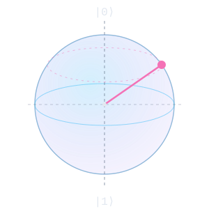
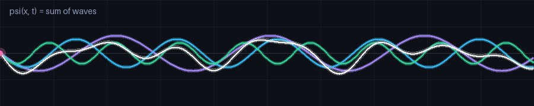

<div align="center">



<br/>



<br/>

<a href="https://www.linkedin.com/in/rohit-sanger-9a80a8277"></a>
<a href="mailto:rohitsanger1893@gmail.com"></a>


<br/>



</div>


## ⚛️ Measure me

<table>
<tr>
<td width="62%" valign="top">

Right now I'm in a superposition. Open one to collapse it into a single state.

<details>
<summary><b>|AI/ML⟩ &nbsp;—&nbsp; machine learning &amp; deep learning</b></summary>

<br/>

- Interested in deep learning
- Oracle Cloud Infrastructure (OCI) AI Foundations certified
- Built **TradAdvise**, which uses AI for stock analysis

</details>

<details>
<summary><b>|Backend⟩ &nbsp;—&nbsp; Python &amp; FastAPI</b></summary>

<br/>

- Working with Python and FastAPI for backend services
- Looking for backend roles alongside AI/ML work

</details>

<details>
<summary><b>|Android⟩ &nbsp;—&nbsp; mobile apps</b></summary>

<br/>

- Building Android apps
- **TradAdvise** is my main independent Android project

</details>

<details>
<summary><b>|Quantum⟩ &nbsp;—&nbsp; the M.Tech</b></summary>

<br/>

- Pursuing M.Tech in Quantum Information &amp; Technology at IIIT Allahabad
- Still early in this field, learning it step by step

</details>

</td>
<td width="38%" align="center" valign="middle">



<sub>A qubit state rotating on the Bloch sphere</sub>

</td>
</tr>
</table>


## 🧪 Project

<table>
<tr>
<td width="60%">

### 📈 TradAdvise
An AI-powered stock analysis app for Android.

`Android` &nbsp; `AI` &nbsp; `Stock analysis`

**[→ See it on GitHub](https://github.com/ROHIT9897)**

</td>
<td width="40%" align="center">

```
  price ─╮
         ├─▶ model ─▶ insight
  news  ─╯
```

</td>
</tr>
</table>

<div align="center">



</div>


## 🧰 Toolbox

<div align="center">


</div>

> Only keep the icons you actually use. Change the `i=` list in this link to edit them.


## 📡 Signal

<div align="center">


<br/><br/>


<br/><br/>

<picture>
  <source media="(prefers-color-scheme: dark)" srcset="https://raw.githubusercontent.com/ROHIT9897/ROHIT9897/output/github-snake-dark.svg" />
  <source media="(prefers-color-scheme: light)" srcset="https://raw.githubusercontent.com/ROHIT9897/ROHIT9897/output/github-snake.svg" />
  
</picture>

</div>

<br/>

<div align="center">


<sub>Open to AI/ML, backend, and Android roles · <a href="mailto:rohitsanger1893@gmail.com">rohitsanger1893@gmail.com</a></sub>

</div>
